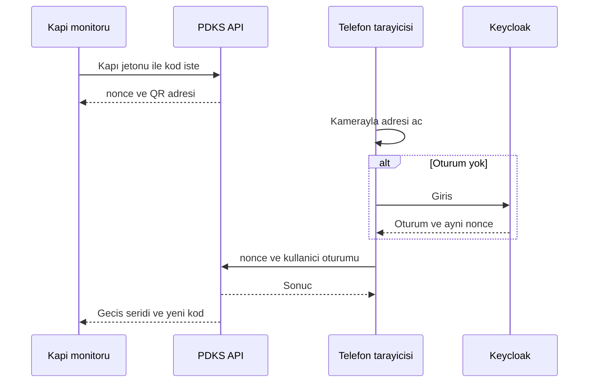

# PDKS Kapı Ekranı Planı

**Tarih:** 5 Kasım 2026  
**Durum:** Planlama  
**Hedef:** Personel devamını, kapı monitöründeki tek kullanımlık kod ve personelin telefon tarayıcısı ile kaydetmek. Kapı monitörü Mng.Ui içinde menüsüz, başlıksız ve günlük giriş istemeyen bir sayfadır. Aynı sayfada dashboard designer ile hazırlanmış bir pano da durur.

Bu belge faz 1’in ürün ve ekran sınırıdır. Ağ kurulumu IT kapsamındadır. Uygulama kodu bu belgeyle yazılmaz.

**İlişkili mevcut parçalar:**

| Parça | Konum | Bu plandaki yeri |
|-------|--------|------------------|
| Menüsüz yerleşim | `Mng.Ui/layouts/blank.vue` | Kapı sayfası bu yerleşimi kullanır. Side menu ve header basılmaz. |
| Oturum zorunluluğu | `Mng.Ui/middleware/auth.global.js` | Kapı adresi buradaki herkese açık yollara eklenir. Aksi halde sayfa `/auth/login` adresine düşer. |
| Menü izni | `Mng.Ui/middleware/menu-permission.global.ts` | Kapı adresi menü izninden de muaftır. |
| Pano çizimi | `DashboardLayoutRenderer` | Kapı sayfası panoyu bu bileşenle çizer. |
| Pano sayfası | `/dashboards/:slug` | Olduğu gibi kullanılmaz. Ekmek kırıntısı, araç çubuğu ve kullanıcı oturumu vardır. |
| Pano tanımı | `@dashboards` | Kapıya bağlanacak pano, dashboard designer ile burada hazırlanır. |

---

## 1. Kilitli kararlar

1. İlk sürümde mağaza uygulaması yoktur. Personel telefonun kendi kamerasıyla kodu okutur. Kod bir HTTPS adresi taşır. Sayfa tarayıcıda açılır.
2. Personelin kimliği, telefon sayfasındaki Keycloak oturumudur. Telefon numarası okunmaz ve eşleştirme anahtarı değildir.
3. Kapı monitörü personel girişi yapmaz. Kullanıcı adı ve şifre ekranı gösterilmez.
4. Kapı sayfası Mng.Ui içindedir. `blank` yerleşim kullanılır. Side menu, header ve benzeri kabuk görünmez.
5. Kapı sayfasında üç şey bir aradadır: geçiş kodu, son geçiş bilgisi, kapı kaydında seçilmiş tek pano.
6. Pano, dashboard designer ile hazırlanır. Kapı sayfası yeni bir pano düzenleyici içermez. Yalnızca seçilen panoyu gösterir.
7. Merkez ve şube iki ayrı kapı kaydıdır. İki ayrı monitör adresi açılır. İki Wi-Fi’yi birleştirmek uygulamanın işi değildir.
8. Kayıt, “kim, hangi kapı, giriş mi çıkış mı, ne zaman” olayından ibarettir. Vardiya, geç kalma ve fazla mesai bu fazda hesaplanmaz.
9. Yön, kişinin son olayından çıkar. Son olay girişse yenisi çıkıştır. Çıkışsa veya o gün kayıt yoksa yenisi giriştir.
10. Aynı kişinin otuz saniye içindeki ikinci okuması yok sayılır. Kod yine de yenilenir.
11. Kod yaklaşık on saniye yaşar, sunucuda üretilir ve bir kez kullanılır.
12. Başarılı geçiş hem telefonda hem kapı şeridinde görünür. Kapı şeridinde ad ve saat yeter. Soyad, sicil ve telefon gösterilmez.

---

## 2. Bu fazda olmayanlar

- App Store veya Google Play uygulaması
- Telefon numarası okuma
- Bluetooth veya Wi-Fi ile yakınlık kontrolü
- Telefonsuz personel için manuel kayıt
- Çevrimdışı kuyruk
- Gün sonunda otomatik çıkış kapatma
- Puantaj ve mesai motoru
- Şube ile merkez arasında VPN veya ortak Wi-Fi
- Kapı monitöründen pano düzenleme

---

## 3. Üç yüzey

| Yüzey | Adres | Yerleşim | Oturum | Kim kullanır |
|-------|--------|----------|--------|----------------|
| Kapı ekranı | `/kapi/{doorKey}` | `blank` | Günlük giriş yok. Adres, kurulumda üretilen kapı jetonunu taşır. | Kapı monitörü |
| Telefon sayfası | `/gecis` | `blank` | Keycloak. Oturum yoksa girişe gider, sonra aynı koda döner. | Personel telefonu |
| Yönetim | Normal Mng.Ui sayfaları | Varsayılan kabuk (menü ve header durur) | Keycloak, yetkili kullanıcı | İK veya yönetici |

Kapı ekranı ile telefon sayfası birbirinin yerine geçmez. Monitör kodu gösterir. Telefon kodu tüketir.

---

## 4. Kapı ekranı

### 4.1 Açılış

Monitörün tarayıcısı, kurulumda bir kez şu biçimde bir adrese sabitlenir:

`/kapi/merkez?k={kioskToken}`

`doorKey` kapıyı seçer (`merkez`, `sube`). `kioskToken` o kapı için üretilmiş uzun ve tahmin edilemeyen değerdir. Bu bir kullanıcı girişi değildir. Monitörde login formu açılmaz. Jeton tarayıcı yer iminde durur. Gün içinde şifre sorulmaz.

Jeton yoksa veya geçersizse sayfa panoyu ve kodu çizmez. Kısa bir “kapı tanımsız” iletisi yeter. Login sayfasına yönlendirme yapılmaz.

`auth.global.js` içindeki herkese açık yol listesine `/kapi/` eklenir. `menu-permission.global.ts` aynı öneki menü kontrolünün dışında bırakır. Aksi halde jetonsuz oturum, sayfayı login ekranına veya yetkisiz sayfaya götürür.

### 4.2 Yerleşim

Sayfa iki banta ayrılır.

```
+--------------------------------------------------+
|  QR kodu          Son geçiş                      |
|                   Ayşe · Giriş · 08:42 · Merkez  |
|                   kısa son geçiş listesi         |
+--------------------------------------------------+
|                                                  |
|  Seçilen panonun DashboardLayoutRenderer çıktısı |
|  Araç çubuğu, ekmek kırıntısı ve düzenle yok     |
|                                                  |
+--------------------------------------------------+
```

Üst bant geçişin kendisidir. Alt bant, o kapıya bağlanmış panodur. Pano, kod yenilendikçe baştan yüklenmez. Kendi yenileme aralığında kalır.

Başarılı geçişte üst bant birkaç saniye “Hoş geldiniz” veya “İyi günler” gösterir. Ardından yeni kod gelir. Alt bant bu sırada yerinde durur.

Bağlantı kopunca eski kod ekranda bırakılmaz. Üst bant “bağlantı yok” der. Süresi dolmuş bir kod okutulamaz.

### 4.3 Pano

Pano, dashboard designer’da hazırlanır ve `@dashboards` kaydında durur. Kapı kaydı bu panonun `slug` değerini tutar. Kapı sayfası `/dashboards/{slug}` rotasını iframe ile açmaz. O rotada ekmek kırıntısı, dışa aktarma ve kullanıcı oturumu vardır.

Kapı sayfası layout satırlarını `DashboardLayoutRenderer` ile çizer. `canEdit` kapalıdır. Widget ayarı, düzenle ve sil kapı ekranında yoktur.

Kapı jetonu tek bir panoyu okuyabilir: kapı kaydında seçili olan. Başka bir `slug` bu jetonla açılmaz. Widget verisi, tarayıcıdaki bir yönetici oturumuyla çekilmez. Sunucu, kapı jetonunu doğruladıktan sonra o panonun verisini kendi tarafında hazırlar. Tarayıcıya Keycloak kullanıcı oturumu yazılmaz.

Panoya konacak widget’lar kapı ortamına uygun seçilir. Personel listesi, ücret veya kimlik numarası taşıyan widget bu ekrana konmaz. Kapı herkese açık bir alanda durur.

---

## 5. Telefon sayfası

Kodun içindeki adres `/gecis?n={nonce}` biçimindedir. `nonce` tek kullanımlık geçiş kodudur.

1. Sayfa oturum arar.
2. Oturum yoksa Keycloak girişine gider. Dönüş adresi aynı `nonce` değerini taşır.
3. Oturum varsa sunucu kodu doğrular: imza veya kayıt geçerli, süre dolmamış, daha önce kullanılmamış, kapı aktif.
4. Kullanıcı, devam kaydı açmaya yetkili gruptadır ve hesabı aktiftir.
5. Yön, son olaya göre yazılır. Olay kaydı oluşur. Kod tüketilir.
6. Telefonda sonuç görünür: ad, yön, saat, kapı adı.
7. Aynı sonuç kapı ekranının üst bandına iletilir.

Sayfayı yenilemek ikinci kayıt açmaz. Kod ilk başarılı istekte tüketilmiştir.

Keycloak istemcisi public istemcidir. Uygulamaya gizli anahtar konmaz. Giriş, Authorization Code ve PKCE ile yapılır. Dönüş adresleri Keycloak’ta tek tek yazılıdır.

Oturum süresi birkaç gün mertebesinde tutulur. Her okutmada şifre sormak kapıda kuyruk oluşturur. Aylarca düşmeyen oturum, kayıp telefonda kaydı açık bırakır.

---

## 6. Geçiş kuralları

| Kural | Değer |
|-------|--------|
| Kod ömrü | Yaklaşık 10 saniye. Okunmasa da süre dolunca yenilenir. |
| Kullanım | Bir başarılı geçişte bir kez. |
| Çift okuma | Aynı kişi, 30 saniye içinde tekrar okutursa olay yazılmaz. |
| Yön | Son olay giriş ise çıkış. Çıkış veya gün içinde olay yoksa giriş. |
| Yetki | Keycloak’ta devam kaydı grubunda olan aktif kullanıcı. |
| Saat | Kayıt UTC. Ekranda Europe/Istanbul. |
| Kapı şeridi | Ad, yön, saat, kapı adı. |
| Red | Süresi dolmuş, kullanılmış, yetkisiz ve tanımsız kapı denemeleri de yazılır. |

Ayrı giriş ve çıkış turnikesi gerekirse her turnike kendi kapı kaydıdır. Yön, kapı kaydında sabitse son olay kuralı o kapıda uygulanmaz. Kapı “yalnız giriş” veya “yalnız çıkış” olur.

---

## 7. Kapı kaydı

Her fiziksel monitör bir kapı kaydıdır. Yönetim ekranından, normal Mng.Ui oturumuyla oluşturulur.

| Alan | Anlamı |
|------|--------|
| `doorKey` | Adreste kullanılan kısa ad. Örnek: `merkez`, `sube`. |
| `title` | Ekranda görünen ad. Örnek: Merkez Giriş. |
| `dashboardSlug` | `@dashboards` içinden seçilen panonun slug değeri. |
| `directionMode` | `auto`, `in`, `out`. Faz 1 varsayılanı `auto`. |
| `active` | Pasif kapı kod üretmez. |
| `kioskTokenHash` | Kapı jetonunun özeti. Jetonun kendisi kayıtta düz durmaz. |

Yönetici kaydı kaydettikten sonra monitör adresini bir kez kopyalar ve kapı tarayıcısının yer imine koyar. Adres günlük işlerde dolaştırılmaz. Jeton sızarsa yönetim ekranından yenilenir. Eski adres o anda geçersiz olur.

Merkez ve şube için iki kayıt açılır. İkisi aynı panoyu da kullanabilir, ayrı panolar da seçebilir. Olaylar `doorKey` ile ayrılır.

---

## 8. Olay kaydı

| Alan | Anlamı |
|------|--------|
| `personId` | Keycloak kullanıcı kimliği. |
| `displayName` | Kapı şeridi ve telefon sonucu için ad. |
| `doorKey` | Kapı. |
| `direction` | `in` veya `out`. |
| `occurredAt` | UTC zaman. |
| `result` | `accepted`, `ignored` (çift okuma), `rejected`. |
| `rejectReason` | Süre, kullanılmış kod, yetki, pasif kapı. Kabul edilen kayıtta boş. |

Günün listesi yönetim yüzeyindedir. Menü ve header ile açılır. Tarih, kapı ve kişi süzülür. Bu liste kapı monitörüne konmaz. Pilot, kaydın düştüğünü bu listeden görür.

---

## 9. Akış



---

## 10. Ağ

Uygulama iki lokasyonun Wi-Fi ağlarını birleştirmez. Kapı monitörü ve telefon, IT’nin yayınladığı HTTPS adına gider. Merkez ve şube bu adresi ayrı hatlardan açar. Telefonun mobil veriden açması da aynı addır.

Uygulamanın beklediği koşullar:

- Kapı sayfası ve `/gecis` adresi her iki lokasyondan ve mobil veriden açılır.
- Keycloak dönüşü iç IP’ye düşmez. Telefonun eriştiği adreste tamamlanır.
- Sertifika herkese açık ve geçerlidir.
- Kopan hat, o kapıda kodu durdurur. Kayıt tek merkezde tutulur. Çevrimdışı biriktirme yoktur.

---

## 11. Güvenlik ve KVKK

Devam kaydı kişisel veridir. Amaç devam takibidir. Saklama süresi ve kimin listeyi göreceği işletmeyle yazılı olur.

Kapı jetonu bir personel yetkisi değildir. Pano düzenleyemez, başka kapının olayını yazamaz, kullanıcı yönetemez.

Kapı ekranı herkesin baktığı bir alandır. Üst bant ve seçilen pano, bu alanda gösterilmesi uygun olmayan alanları taşımaz.

Reddedilen denemeler silinmeden durur. İstismar ve “okuttum, kayıt yok” şikayeti buradan izlenir.

---

## 12. Faz sınırı

Faz 1 bittiğinde şunlar çalışır:

- İki kapı kaydı, iki monitör adresi, günlük login yok
- Menüsüz kapı sayfasında kod, geçiş şeridi ve seçilmiş pano
- Telefonda Keycloak ile tek kullanımlık kodun tüketilmesi
- Giriş ve çıkışın son olaya göre yazılması
- Çift okumanın yok sayılması
- Yetkili kullanıcının gün listesini normal Mng.Ui kabuğunda görmesi

Faz 2 adayları, pilot bunu isterse ele alınır: manuel kayıt, yakınlık kontrolü, mağaza uygulaması, puantaj kuralları, çevrimdışı kuyruk.

---

## 13. Uygulamaya geçerken ilk dokunulacak yerler

Kod bu plan onaylanmadan yazılmaz. Onay sonrası sıra şöyledir:

1. Kapı ve olay kayıtlarının şeması
2. Kod üretme ve tüketme API’si
3. `/kapi/{doorKey}` sayfası, `blank` yerleşim, herkese açık yol istisnası
4. Seçili panoyu `DashboardLayoutRenderer` ile çizmek
5. `/gecis` sayfası ve Keycloak dönüş adresi
6. Yönetim: kapı kaydı, pano seçimi, jeton yenileme, gün listesi
