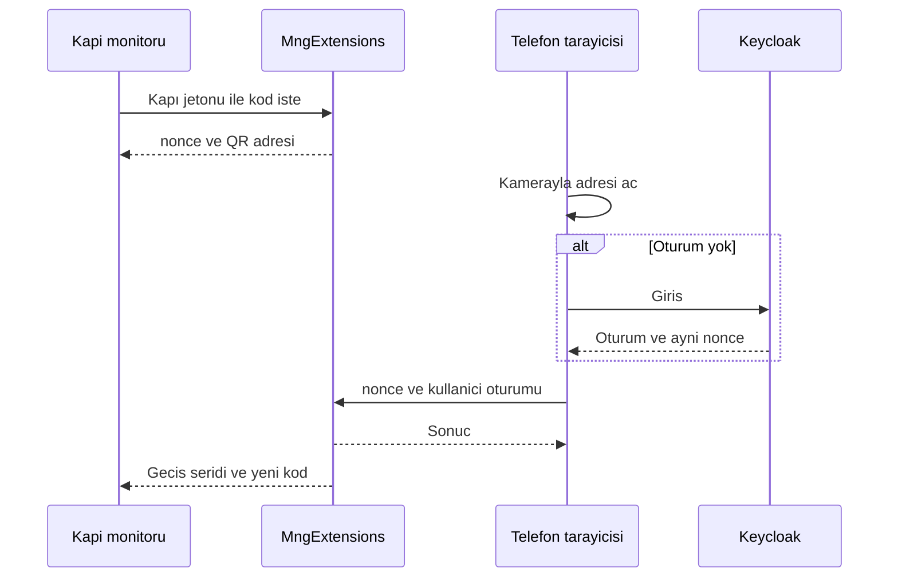

# PDKS Kapı Ekranı Planı

**Tarih:** 5 Kasım 2026  
**Son düzenleme:** 20 Kasım 2026  
**Durum:** Kapı, tarayıcı geçişi, mola ve devam panosu canlıda. Anlık durum ve rapor yazıldı. Prova yerel arayüzde. Canlı arayüz imajı bu iki sayfayı henüz taşımıyor.  
**Hedef:** Personel devamını, kapı monitöründeki tek kullanımlık kod ve personelin telefon tarayıcısı ile kaydetmek. Kapı monitörü Mng.Ui içinde menüsüz, başlıksız ve günlük giriş istemeyen bir sayfadır. Aynı sayfada o günün devam panosu durur.

Bu belge faz 1’in ürün ve ekran sınırıdır. Ağ kurulumu IT kapsamındadır. Uygulama kodu bu belgeyle yazılmaz.

**İlişkili mevcut parçalar:**

| Parça | Konum | Bu plandaki yeri |
|-------|--------|------------------|
| Menüsüz yerleşim | `Mng.Ui/layouts/blank.vue` | Kapı sayfası bu yerleşimi kullanır. Side menu ve header basılmaz. |
| Oturum zorunluluğu | `Mng.Ui/middleware/auth.global.js` | Kapı adresi buradaki herkese açık yollara eklenir. Aksi halde sayfa `/auth/login` adresine düşer. |
| Menü izni | `Mng.Ui/middleware/menu-permission.global.ts` | Kapı adresi menü izninden de muaftır. |
| Pano çizimi | Kapı sayfası | `kapi-is-ozeti` devam panosunu sunucunun hazırladığı paketle çizer. |
| Pano sayfası | `/dashboards/:slug` | Olduğu gibi kullanılmaz. Ekmek kırıntısı, araç çubuğu ve kullanıcı oturumu vardır. |
| Pano tanımı | `@dashboards` | Kapıya bağlanacak pano, dashboard designer ile burada hazırlanır. |

---

## 1. Kilitli kararlar

1. İlk sürümde mağaza uygulaması yoktur. Personel telefonun kendi kamerasıyla kodu okutur. Kod bir HTTPS adresi taşır. Sayfa tarayıcıda açılır.
2. Personelin kimliği, telefon sayfasındaki Keycloak oturumudur. Telefon numarası okunmaz ve eşleştirme anahtarı değildir.
3. Kapı monitörü personel girişi yapmaz. Kullanıcı adı ve şifre ekranı gösterilmez.
4. Kapı sayfası Mng.Ui içindedir. `blank` yerleşim kullanılır. Side menu, header ve benzeri kabuk görünmez.
5. Kapı sayfasında üç şey bir aradadır: geçiş kodu, son geçiş bilgisi, kapı kaydında seçilmiş tek pano.
6. Pano, dashboard designer ile hazırlanır. Kapı sayfası yeni bir pano düzenleyici içermez. Yalnızca seçilen panoyu gösterir.
7. Merkez ve şube iki ayrı kapı kaydıdır. İki ayrı monitör adresi açılır. İki Wi-Fi’yi birleştirmek uygulamanın işi değildir.
8. Kayıt, “kim, hangi kapı, giriş mi çıkış mı, ne zaman” olayından ibarettir. Erken, zamanında ve geç sınıfı bu olayın üstüne, ayar satırındaki saatle bakan bir sorgudur. Kişiye özel vardiya ve fazla mesai hesabı yoktur.
9. Yön, kişinin Europe/Istanbul günündeki son kabul edilmiş olayından çıkar. Son olay girişse yenisi çıkıştır. O gün kayıt yoksa yenisi giriştir. Aynı gün kabul edilmiş bir giriş ve ondan sonraki bir çıkış varsa gün kapanır. Yeni okutma buton göstermez ve satır yazmaz. Ertesi sabah yeniden giriş açılır.
10. Aynı kişinin otuz saniye içindeki ikinci okuması yok sayılır. Kod yine de yenilenir.
11. Kod yaklaşık on saniye yaşar, sunucuda üretilir ve bir kez kullanılır. Ekrandaki kod bu sürede yenilenir.
12. Başarılı geçiş hem telefonda hem kapı şeridinde görünür. Kapı şeridinde ad ve saat yeter. Soyad, sicil ve telefon gösterilmez.
13. 12 Kasım 2026: Şifre her okutmada sorulabilir. Birkaç günlük oturum bu fazın şartı değildir. Telefon, kodun on saniyesi içinde linki açarsa sunucu o kodu bir kez tutar ve şifre için yaklaşık doksan saniye ekler. Süre dolmuşsa şifre sorulmaz. Şifre yetişirse aynı kod yazılır. Süre ikinci kez uzamaz. Fotoğrafı geç açan kişi ek süreyi alamaz.
14. 17 Kasım 2026: Mağaza uygulaması `Mng.Mobile` içindedir. MBL-01’den MBL-05’e kadar Expo Go ile denendi. Güncelleme mağaza sürümüdür. Android herkese açık yayın, bir Play Console hesabı bulunana kadar durur. Tarayıcıdaki şifreli geçiş durur.
15. 19 Kasım 2026: Mola aynı kapı koduyla yazılır. Yönler `break` ve `return` dir. Gün mola ile kapanmaz. Erken ve geç, ilk giriş ile son çıkışa bakar. Otuz saniyelik yok sayma yalnız aynı işlem içindir. Açık moladayken çıkış, aynı anda sessiz bir dönüş satırı yazar.
16. 19 Kasım 2026: `kapi-is-ozeti` kapı bandı iş grafiği çizmez. Devam panosu bugün gelen, içeride, molada ve çıkan kişileri sayar. Kabul edilen her satır damgayı artırır. Kapı sayfası kod yoklamasında damga değişince panoyu yeniler.
17. 20 Kasım 2026: Anlık durum ayrı bir sayfadır. Dashboard designer sayfası değildir. Seçilen lokasyon için kapı panosunun aynı dört sayısını ve listelerini çizer. Yenileme, geçiş damgası değişince olur.
18. 20 Kasım 2026: Rapor personel satırı ve gün gruplarıdır. Gün, geç geldi, erken çıktı ve geç çıktı sayaçları bu sürümde yoktur. Her günün altında giriş, çıkış, mola sayısı, mola süresi ve çalışma durur.

---

## 2. Bu fazda olmayanlar

- Mağaza uygulaması bu fazın çalışan diliminde yoktur. Tasarımı 14. bölümde kilitlendi.
- Telefon numarası okuma
- Bluetooth veya Wi-Fi ile yakınlık kontrolü
- Telefonsuz personel için manuel kayıt
- Çevrimdışı kuyruk
- Gün sonunda otomatik çıkış kapatma
- Kişiye özel vardiya ve fazla mesai hesabı
- Şube ile merkez arasında VPN veya ortak Wi-Fi
- Kapı monitöründen pano düzenleme

---

## 3. Üç yüzey

| Yüzey | Adres | Yerleşim | Oturum | Kim kullanır |
|-------|--------|----------|--------|----------------|
| Kapı ekranı | `/kapi/{doorKey}` | `blank` | Günlük giriş yok. Adres, kurulumda üretilen kapı jetonunu taşır. | Kapı monitörü |
| Telefon sayfası | `/gecis` | `blank` | Keycloak. Oturum yoksa girişe gider, sonra aynı koda döner. | Personel telefonu |
| Yönetim | Normal Mng.Ui sayfaları | Varsayılan kabuk (menü ve header durur) | Keycloak, yetkili kullanıcı | İK veya yönetici |

Kapı ekranı ile telefon sayfası birbirinin yerine geçmez. Monitör kodu gösterir. Telefon kodu tüketir.

---

## 4. Kapı ekranı

### 4.1 Açılış

Monitörün tarayıcısı, kurulumda bir kez şu biçimde bir adrese sabitlenir:

`/kapi/merkez?k={kioskToken}`

`doorKey` kapıyı seçer (`merkez`, `sube`). `kioskToken` o kapı için üretilmiş uzun ve tahmin edilemeyen değerdir. Bu bir kullanıcı girişi değildir. Monitörde login formu açılmaz. Jeton tarayıcı yer iminde durur. Gün içinde şifre sorulmaz.

Jeton yoksa veya geçersizse sayfa panoyu ve kodu çizmez. Kısa bir “kapı tanımsız” iletisi yeter. Login sayfasına yönlendirme yapılmaz.

`auth.global.js` içindeki herkese açık yol listesine `/kapi/` eklenir. `menu-permission.global.ts` aynı öneki menü kontrolünün dışında bırakır. Aksi halde jetonsuz oturum, sayfayı login ekranına veya yetkisiz sayfaya götürür.

### 4.2 Yerleşim

Sayfa iki banta ayrılır.

```
+--------------------------------------------------+
|  QR kodu          Son geçiş                      |
|                   Ayşe · Giriş · 08:42 · Merkez  |
|                   kısa son geçiş listesi         |
+--------------------------------------------------+
|                                                  |
|  Seçilen panonun DashboardLayoutRenderer çıktısı |
|  Araç çubuğu, ekmek kırıntısı ve düzenle yok     |
|                                                  |
+--------------------------------------------------+
```

Üst bant geçişin kendisidir. Alt bant, o kapıya bağlanmış panodur. Pano, kodun her yenilenişinde baştan yüklenmez. Kabul edilen harekette damga değişince yenilenir. Damga durursa kendi yenileme aralığında kalır.

Başarılı geçişte üst bant kısa selamlamayı gösterir. Şerit yaklaşık sekiz saniye durur. Pencerede ad ve soyad birlikte durur. Girişte varsayılan cümle “İyi çalışmalar.” Zamanında girişte “Zamanında geldiğiniz için teşekkürler.” Geç girişte “Yolunuz düştü, yine de hoş geldiniz.” Çıkışta “Güle güle.” Molada “Mola başladı.” Dönüşte “Hoş geldiniz.” Giriş ve çıkış cümleleri `pdks_ayarlar` satırındadır. Boş alan varsayılana döner. Mola ve dönüş cümleleri sabittir. Sınıf yalnız giriş ve çıkışta hesaplanır. Erken giriş, giriş cümlesini kullanır. Çıkışta saat bakılmaz. Mola ve dönüş sınıfa girmez. Reddedilen okutma pencere açmaz. Telefondaki sonuç yaklaşık üç saniye sonra ana sayfaya döner.

Bağlantı kopunca eski kod ekranda bırakılmaz. Üst bant “bağlantı yok” der. Süresi dolmuş bir kod okutulamaz.

### 4.3 Pano

Pano, dashboard designer’da hazırlanır ve `@dashboards` kaydında durur. Panoyu lokasyon seçer. Aynı lokasyondaki kapılar aynı panoyu gösterir. Farklı lokasyonlar farklı pano seçebilir. Kapı kaydındaki eski pano alanı bu seçimin kaynağı değildir. Kapı sayfası `/dashboards/{slug}` rotasını iframe ile açmaz. O rotada ekmek kırıntısı, dışa aktarma ve kullanıcı oturumu vardır.

Örnek pano `kapi-is-ozeti` adını taşır. Bu slug kapı bandında iş grafiği çizmez. Başlık **Devam** dır. Dört kart kişi sayar, olay saymaz. Hepsi bugünün kabul edilmiş geçişidir. Kapıya bölünmez. Gün sınırı Europe/Istanbul’dur.

| Kart | Kim girer |
|------|-----------|
| Bugün gelen | Kabul edilmiş girişi olan kişi |
| İçeride | Girişi var, çıkışı yok, açık molası yok |
| Molada | Açık molası olan kişi |
| Çıkan | Kabul edilmiş çıkışı olan kişi |

İki liste durur. **Gün** adı, giriş saatini ve çıkış saatini gösterir. Çıkış yoksa çıkış hücresi boş kalır. Sıra giriş saatinedir. **Molada** adı, mola başlangıcını ve geçen süreyi gösterir. Süre sayfa saatiyle ilerler. Red ve yok sayılan satır listelenmez. Moladaki kişi içeride sayılmaz. Açık moladayken çıkış, kişiyi çıkanlara alır.

Ücret ve kimlik numarası bu panoya konmaz. Kapı jetonu panoyu sunucudan ister. Tarayıcıya Keycloak oturumu yazılmaz.

Pano Redis’te `pdks:board:v5:{doorKey}` anahtarıyla durur. Ömrü, saat ayarındaki pano yenileme süresidir. Varsayılan altmış saniyedir ve on beş ile altı yüz arasına sıkışır. Kabul edilen her geçiş `pdks:board:stamp` damgasını bir artırır. Açık molayı kapatan sessiz dönüş de damgayı artırır. Önbellek, içindeki damga güncel damgayla aynıysa kullanılır. Kod yoklaması yaklaşık üç saniyede bir `boardStamp` döner. Kapı sayfası damga değişince panoyu yeniden ister. Dakikalık süre yedek olarak durur.

20 Kasım 2026: Pano, gün süzgecini veritabanına bırakmaz. Kabul edilmiş satırı alır ve İstanbul gününü bellekte ayırır. Eski metin saat de, yeni UTC tarih de okunur. Yeni geçiş satırında şema tipi tarih olan alan UTC tarih olarak yazılır.

Kapı jetonu tek bir panoyu okuyabilir: lokasyonda seçili olan. Başka bir `slug` bu jetonla açılmaz. `kapi-is-ozeti` dışında slug boş pano döner. Sunucu, kapı jetonunu doğruladıktan sonra panoyu kendi tarafında hazırlar. Tarayıcıya Keycloak kullanıcı oturumu yazılmaz. Ücret ve kimlik numarası bu ekrana konmaz. Ad ve saat, kapının baktığı alanda durur.

---

## 5. Telefon sayfası

Kodun içindeki adres `https://mng.ankarabt.com/gecis?n={nonce}` biçimindedir. `nonce` tek kullanımlık geçiş kodudur. Sayfa `n` olmadan açılır. Eksik kod “Kod tanınmadı” yazmaz.

Canlı yol tarayıcıdır. Telefon, şifreyle bir kez tanınır. Gizli anahtar tarayıcıda kalır ve dışarı çıkmaz. Kimlik bu anahtarın imzasıdır. IMEI ve telefon numarası okunmaz.

Üç ekran vardır.

1. **Ana sayfa.** Ad büyük durur. PDKS satırı “Kapı kodunu okut” der. Kamera bu satıra basılınca açılır. Adreste `n` varsa sayfa önizlemeye gider.
2. **Okuma.** Arka kamera kodu çerçeveye alır. Geçiş bu karede yazılmaz.
3. **Karar.** Ad, yer ve sunucunun açtığı butonlar durur. Fotoğraf isteniyorsa ön kamera küçük karede durur. Buton geçişi yazar. Kabul ya da gün kapanışı yaklaşık üç saniye sonra ana sayfaya döner. Red, Geri’ye kadar durur.

Butonlar o anki duruma göredir. Giriş yoksa yalnız **Giriş** vardır. Giriş varsa ve mola açık değilse **Çıkış** ile **Mola** vardır. Mola açıksa **Çıkış** ile **Dönüş** vardır. Gün kapanmışsa buton ve fotoğraf yoktur. Yazı “Bugünkü geçiş tamam.” olur. Satır yazılmaz ve kod tutulmaz.

Fotoğraf, İK’nın “Geçişte fotoğraf iste” anahtarı açıksa ve geçiş kabul edilecekse istenir. Mola ve dönüş de bu kurala girer. Kare kimlik doğrulamaz. Saklama, geçiş anından doksan gündür. Silme MngExtensions içindeki `PassagePhotoRetentionService` ile yapılır.

Sayfayı yenilemek ikinci kayıt açmaz. Kod ilk başarılı istekte tüketilmiştir.

20 Kasım 2026: iPhone’daki Safari kapı kodunu yerel okuyucuyla görmez. Sayfa o zaman kodu jsQR ile okur. Android’deki yerel okuyucu durur. Aynı gün iPhone’da denendi.

12 Kasım 2026 kararı durur: şifre sırasında on saniyelik kod bir kez yaklaşık doksan saniye tutulur. Süre dolmuşsa şifre sorulmaz. Aynı kod ikinci kez tutulmaz.

---

## 6. Geçiş kuralları

| Kural | Değer |
|-------|--------|
| Kod ömrü | Ekranda yaklaşık 10 saniye. Okunmasa da süre dolunca yenilenir. |
| Şifre tutması | Link on saniye içinde açılırsa kod bir kez yaklaşık 90 saniye tutulur. Geç açılırsa tutulmaz. |
| Kullanım | Bir başarılı geçişte bir kez. |
| Çift okuma | Aynı kişinin aynı işlemi 30 saniye içinde ikinci kez okutması yok sayılır. Satır `ignored` olarak yazılır ve kod döner. Girişten hemen sonra mola, ayrı işlemdir ve sayılır. |
| Yön | Son iş yönü giriş ise çıkış. Çıkış veya gün içinde iş yönü yoksa giriş. Mola ve dönüş bu sırayı değiştirmez. |
| Gün kapanışı | Aynı İstanbul gününde kabul edilmiş bir giriş ve ondan sonraki bir çıkış günü kapatır. Sonraki okutma “Bugünkü geçiş tamam.” der, satır yazmaz. Yalnız çıkış günü kapatmaz. Mola kapatmaz. Kapının sabit giriş veya çıkış kilidi günü yeniden açmaz. |
| Mola | Girişten sonra açılır. Süresi sabit değildir. Günde birden fazla mola olur. Dün açık kalan mola bugüne taşınmaz. Akşam kendiliğinden kapanmaz. |
| Yetki | Keycloak’ta devam kaydı grubunda olan aktif kullanıcı. |
| Saat | Kayıt UTC. Ekranda Europe/Istanbul. |
| Kapı şeridi | Ad, yön, saat, kapı adı. |
| Red | Süresi dolmuş, kullanılmış, yetkisiz ve tanımsız kapı denemeleri de yazılır. |

Ayrı giriş ve çıkış turnikesi gerekirse her turnike kendi kapı kaydıdır. Yön, kapı kaydında sabitse son olay kuralı o kapıda uygulanmaz. Kapı “yalnız giriş” veya “yalnız çıkış” olur.

---

## 7. Kapı kaydı

Her fiziksel monitör bir kapı kaydıdır. Yönetim ekranından, normal Mng.Ui oturumuyla oluşturulur.

| Alan | Anlamı |
|------|--------|
| `doorKey` | Adreste kullanılan kısa ad. Örnek: `merkez`, `sube`. |
| `title` | Ekranda görünen ad. Örnek: Merkez Giriş. |
| `dashboardSlug` | `@dashboards` içinden seçilen panonun slug değeri. |
| `directionMode` | `auto`, `in`, `out`. Faz 1 varsayılanı `auto`. |
| `active` | Pasif kapı kod üretmez. |
| `kioskTokenHash` | Kapı jetonunun özeti. Jetonun kendisi kayıtta düz durmaz. |
| `ayar` | Kapı geçiş ayarı. Boşsa tek ayar satırı geçerlidir. |

Yönetici kaydı kaydettikten sonra monitör adresini bir kez kopyalar ve kapı tarayıcısının yer imine koyar. Adres günlük işlerde dolaştırılmaz. Jeton sızarsa yönetim ekranından yenilenir. Eski adres o anda geçersiz olur.

Merkez ve şube için iki kayıt açılır. İkisi aynı panoyu da kullanabilir, ayrı panolar da seçebilir. Olaylar `doorKey` ile ayrılır.

---

## 8. Olay kaydı

| Alan | Anlamı |
|------|--------|
| `personId` | Keycloak kullanıcı kimliği. |
| `displayName` | Kapı şeridi ve telefon sonucu için ad. |
| `doorKey` | Kapı. |
| `direction` | `in`, `out`, `break`, `return`. |
| `occurredAt` | UTC zaman. Şemada tarih tipidir. Yeni satır UTC tarih olarak durur. |
| `result` | `accepted`, `ignored` (çift okuma), `rejected`. |
| `rejectReason` | Süre, kullanılmış kod, yetki, pasif kapı. Kabul edilen kayıtta boş. |

`personId` bir `persons` alanıdır. Değer, Keycloak kullanıcı kimliğidir. `displayName`, okutma anındaki addır. Kapı şeridi bu adı kullanır. Rapor kişiyi `personId` üzerinden açar.

Günün listesi yönetim yüzeyindedir. Menü ve header ile açılır. Tarih, kapı ve kişi süzülür. Bu liste kapı monitörüne konmaz. Pilot, kaydın düştüğünü bu listeden görür.

---

## 8.1 Kapı geçiş ayarları

Kurumun beklenen mesai saatidir. İzin ayarı gibi tek satırla açılır. İkinci satır, şube veya başka bir gün ayrı saat istediğinde açılır. O zaman kapı kaydındaki `ayar` o satırı seçer. Boş `ayar`, `tekil` değeri `ayar` olan satırı kullanır.

| Alan | Anlamı |
|------|--------|
| `tekil` | Tek satırı tutan anahtar. İlk kayıtta `ayar`. |
| `girisSaati` | Beklenen giriş. Europe/Istanbul günündeki saat. Örnek: `08:30`. Bir an değildir. |
| `cikisSaati` | Beklenen çıkış. Aynı biçimde. |
| `toleransDakika` | Zamanında sayılan ek dakika. Sıfırsa zamanında olan yalnız tam o dakikadır. |

Saat metindir ve `SS:dd` kalıbındadır. UTC zaman damgası kullanılmaz. Gerçek okutma geçiş satırında UTC kalır.

Sorgu, kabul edilmiş geçişi okur. Çift okuma ve red sınıfa girmez. Geliş, kişinin o günkü ilk girişidir. Çıkış, o günkü son çıkışıdır. Gün sınırı Europe/Istanbul’dur.

| Sınıf | Kural |
|--------|--------|
| Erken geldi | İlk giriş, beklenen giriş saatinden önce |
| Zamanında geldi | İlk giriş, beklenen saat ile saat + tolerans arasında |
| Geç geldi | İlk giriş, toleransın bitiminden sonra |
| Erken çıktı | Son çıkış, beklenen çıkış saatinden önce |
| Zamanında çıktı | Son çıkış, beklenen saat ile saat + tolerans arasında |
| Geç çıktı | Son çıkış, toleransın bitiminden sonra |

Bu sorgular kapı ekranında çalışmaz. Kişiye özel vardiya bu satıra yazılmaz.

---

## 8.2 Dataset’ler ve yazma jetonu

Üç dataset vardır. Kod bu dataset’lere yazılmaz. Kod yaklaşık on saniye yaşar, bir kez kullanılır ve sunucuda tüketilir.

| Dataset | Dosyadaki ad | Ne tutar | Kim yazar |
|---------|----------------|----------|-----------|
| Kapı | `pdks_kapilar` | Monitör, jeton özeti, pano, yön kipi, ayar bağı | Yönetici, kendi oturumuyla |
| Geçiş | `pdks_gecisler` | Kişi, kapı, yön, zaman, sonuç | Sunucu, seçilen teknik kullanıcıyla |
| Kapı geçiş ayarları | `pdks_ayarlar` | Giriş saati, çıkış saati, tolerans | Yönetici, kendi oturumuyla |

Şema `datasets/pdks_datasets.json` içindedir.

Telefon jetonu kimliği kanıtlar. Geçiş satırını o jeton yazmaz. Kapı monitörü yazma jetonunu görmez. Yazmayı seçilen bir kullanıcı yapar. Bu kullanıcı yalnız geçiş dataset’ine yazmak için açılır. Parolası dataset’te durmaz; sunucu sırrındadır. MngScheduler’daki servis hesabı ile aynı kalıptır: alan adı, kullanıcı adı, parola, Keeper’dan alınan ve bellekte tutulan jeton.

DataGateway satırın oluşturan bilgisine bu jetonun sahibini yazar. Rapordaki kişi `personId` alanındadır. Günlük yönetici hesabı bu işe bağlanmaz. O hesabın parolası değişince kapı durmasın ve her satırın oluşturanı o yönetici görünmesin diye ayrı hesap kullanılır.

Oluşturma yetkisi teknik kullanıcının grubundadır. Okuma, gün listesini ve raporu görecek gruptadır. Personel grubunun geçiş dataset’inde oluşturma yetkisi yoktur.

---

## 8.3 Servis, ağ geçidi ve kurulum

Kod **MngExtensions** içindedir. İskelet MngNotifier ile aynıdır: Domain, Application, Infrastructure, Persistence, Api. PDKS bu servisin ilk modülüdür. Yarınki başka bir kurum prosedürü aynı serviste yeni bir modül olur.

Servis MngGateway arkasındadır. Dış adres `/extensions` önekidir. Operation Core’un `/operations` öneki ile aynı kalıp. Kapı sayfası ve telefon, servisin kendi portuna değil, yayınlanan adrese gider. Canlı adres `https://mng.ankarabt.com` dir. Kapı `https://mng.ankarabt.com/kapi` dir.

Kurulum `ApplicationResources/mng_apps` altındaki production compose ile `docker-compose.ankarabt.local.apps.yml` override’ıdır. İmaj ofisteki `192.168.1.249` sunucusuna alınır. Kapı jetonu, telefon anahtarı ve geçiş satırı sunucudaki Keeper, DataGateway ve Redis ile doğrulanır. Geçiş satırını servis hesabı yazar. Bu hesap bugün `abt_admin` dir.

---

## 9. Akış



---

## 10. Ağ

Uygulama iki lokasyonun Wi-Fi ağlarını birleştirmez. Kapı monitörü ve telefon, IT’nin yayınladığı HTTPS adına gider. Merkez ve şube bu adresi ayrı hatlardan açar. Telefonun mobil veriden açması da aynı addır.

Uygulamanın beklediği koşullar:

- Kapı sayfası ve `/gecis` adresi her iki lokasyondan ve mobil veriden açılır.
- Keycloak dönüşü iç IP’ye düşmez. Telefonun eriştiği adreste tamamlanır.
- Sertifika herkese açık ve geçerlidir.
- Kopan hat, o kapıda kodu durdurur. Kayıt tek merkezde tutulur. Çevrimdışı biriktirme yoktur.

---

## 11. Güvenlik ve KVKK

Devam kaydı kişisel veridir. Amaç devam takibidir. Saklama süresi ve kimin listeyi göreceği işletmeyle yazılı olur.

Kapı jetonu bir personel yetkisi değildir. Pano düzenleyemez, başka kapının olayını yazamaz, kullanıcı yönetemez.

Kapı ekranı herkesin baktığı bir alandır. Üst bant ve seçilen pano, bu alanda gösterilmesi uygun olmayan alanları taşımaz.

Reddedilen denemeler silinmeden durur. İstismar ve “okuttum, kayıt yok” şikayeti buradan izlenir.

---

## 12. Faz sınırı

Faz 1 bittiğinde şunlar çalışır:

- Üç dataset: kapı, geçiş, kapı geçiş ayarları
- İki kapı kaydı, iki monitör adresi, günlük login yok
- Menüsüz kapı sayfasında kod, geçiş şeridi ve seçilmiş pano
- Telefonda Keycloak ile tek kullanımlık kodun tüketilmesi
- Geçiş satırının teknik kullanıcı jetonuyla yazılması
- Giriş ve çıkışın son olaya göre yazılması
- Çift okumanın yok sayılması
- Yetkili kullanıcının gün listesini normal Mng.Ui kabuğunda görmesi
- Erken, zamanında ve geç sınıflarını ayar satırından okuyan sorgular

Faz 2 adayları, pilot bunu isterse ele alınır: manuel kayıt, yakınlık kontrolü, kişiye özel vardiya, fazla mesai hesabı, çevrimdışı kuyruk. Mağaza uygulamasının tasarımı 14. bölümde kilitlendi.

---

## 13. Geliştirme sırası

Sıra 11 Kasım 2026’da kilitlendi. Bir dilim bitmeden sonrakine geçilmez.

| Dilim | İş | Bittiğinde |
|-------|-----|------------|
| PDKS-01 | `pdks_kapilar`, `pdks_gecisler`, `pdks_ayarlar` şeması | Üç dataset tanımı dosyada durur. Saatler bilinince ilk ayar satırı yazılır. |
| PDKS-02 | MngExtensions içinde kod üretme ve tüketme. Geçişi teknik kullanıcı yazar. | Uçlar `/extensions/api/v1/pdks` altından açılır. Telefon jetonu kimliği kanıtlar. Satır `pdks_gecisler` içine düşer. Kod Redis’te durur. |
| PDKS-03 | `/kapi/{doorKey}` sayfası | `blank` yerleşim, herkese açık yol, üst bantta kod ve şerit, alt bantta seçili pano. Pano kod yenilenince baştan yüklenmez. |
| PDKS-04 | `/gecis` sayfası | Keycloak dönüşü aynı kodu taşır. Sonuç telefonda görünür. Yenileme ikinci kayıt açmaz. |
| PDKS-05 | Yönetim | Kapı kaydı, pano seçimi, jeton yenileme, ayar satırı, gün listesi. |
| PDKS-06 | Sınıf sorguları | Erken, zamanında ve geç. Kapı ekranında çalışmaz. |

Kapı sayfasının sözleşmesi konuşuldu. Üst bant kodu ve son geçişleri kısa aralıkla ister. Bağlantı kopunca eski kod ekranda kalmaz. Alt bant, kapı jetonu doğrulandıktan sonra sunucunun hazırladığı pano paketini çizer. Widget’lar tarayıcıdaki kullanıcı jetonuyla kendi adreslerine gitmez. Geçersiz jeton login sayfasına düşmez.

---

## 14. PDKS Mobil App

12 Kasım 2026 akşamı kilitlendi. 17 Kasım 2026’da kabuk React Native ve Expo ile `Mng.Mobile` içine açıldı. Flutter kabuğu bırakıldı. Anahtar, onay, modül listesi, geçiş ve ön kamera aynı gün yazıldı ve Expo Go ile denendi. Tarayıcıdaki şifreli geçiş durur. Uygulama yüklü değilse aynı kod bugünkü sayfayı açar. Sıradaki adım yayındır. Android tarafı bir Play Console hesabına kadar durur.

### 14.1 Telefonun kimliği

Telefonu tanıyan şey, o AD hesabına bağlı anahtardır. IMEI ve telefon numarası kapıyı açmaz. Uygulama bu numaraları okumaz.

Gizli anahtar telefonun içinde üretilir ve telefondan çıkmaz. İK, MonitraNG personel ekranından bu telefonu onaylar, reddeder, kaldırır veya yeniden üretim ister. Keycloak’ta gizli anahtar durmaz. Duran şey açık anahtar ve onay durumudur.

Yüz tanıma ve parmak izi yoktur.

### 14.2 Kurulum

1. Uygulama telefona kurulur.
2. İlk açılışta, şifreden önce sunucu adresi sorulur. Varsayılan `https://mng.ankarabt.com` gelir. Yalnızca `https` kabul edilir. Adres telefonda saklanır.
3. Personel bir kez kullanıcı adı ve şifresiyle girer. Bu giriş kapıya geçiş yazmaz.
4. Telefon gizli anahtarını kendi içinde üretir ve onay ister.
5. Telefonda anahtar yoksa yükleme butonu onayın gelip gelmediğine bakar. Onay varsa telefon tanınır.
6. Uygulama anahtarı değiştiremez, yenisini yazamaz ve “anahtarı kaldır” veya “hesabı değiştir” sunmaz.
7. İK anahtarı kaldırır veya yeniden isterse telefondaki anahtar geçersiz olur. Uygulama sıfır kurulum gibi davranır: şifre, yeni anahtar, yeniden İK onayı.
8. Sunucu adresi değiştirilirse telefondaki gizli anahtar düşer. Yeni adres yeni kurulumdur. Eski sunucudaki onay, İK silmeden durur. Anahtar telefondan silindiği için geri dönmek de yeni anahtar ve yeni onay ister.

Ayarlarda salt okunur üç satır durur: bağlı sunucu, tanınan personel, anahtarın durumu. Durum yok, onay bekliyor veya geçerlidir.

### 14.3 Kodun açılışı

QR bugünkü adresi taşır: `https://mng.ankarabt.com/gecis?n=...` İçinde uygulama özel bir şema yoktur. Uygulama yüklüyse işletim sistemi linki uygulamada açar. Yüklü değilse tarayıcı açılır.

PDKS açılınca arka kamera görünür ve bu QR’ı okur. Personel adresi yazmaz. Okunan adres, ayarlardaki sunucu adresiyle aynı olmalı ve yolu `/gecis` ile bitmelidir. Farklıysa kod işlenmez. Kamera kare göndermez; yalnız kodu taşır.

### 14.4 Sorunsuz geçiş

Personel PDKS ekranındaki arka kamerayı monitördeki koda tutar. Uygulama kodu okur okumaz ayırır. Ekrandaki kod yenilense bile bu okutma düşmez. Sunucu bu anda geçiş yazmaz. Telefonun kendi kamerasıyla okutulan link de aynı ayırmayı açar; bu, uygulama kuruluyken geçerlidir.

Uygulama saati, lokasyonu, kapıyı, kişinin adını ve yönü gösterir. Yönü personel serbestçe seçmez. Sunucunun açtığı buton **Giriş**, **Çıkış**, **Mola** veya **Dönüş** olur. Kuralları bölüm 6 ile aynıdır. Kurulu önizleme paketi mola butonunu taşımayabilir. Canlı mola tarayıcıdadır.

Fotoğraf parametresi açıksa ve telefon kameraya izin vermişse ekranda ön kamera durur. Personel kendi yüzünü görür. Butona basınca o anki kare alınır, onaylı anahtar kodu imzalar ve geçiş yazılır. Kare kimlik doğrulamaz.

Aynı anda monitördeki karşılama şeridi açılır. Kapı, yön, ad soyad ve karşılama cümlesi orada durur. QR ekranda kalır.

### 14.5 Fotoğraf parametresi

Parametreyi İK, personel ekranından açar veya kapatır. Uygulamada bu anahtar yoktur.

Kapı kodunu okuyan arka kamera fotoğraf parametresinden bağımsızdır. İzin bir kez sorulur.

Parametresi kapalı kişide ön kamera açılmaz. Yüz için ikinci bir izin sorusu çıkarmaz. Geçiş onaylı anahtarla yazılır.

Parametresi açık kişide ön kamera geçiş ekranındadır. İlk seferde telefonun kendi izin sorusu gelir. İzin verilirse sonraki geçişlerde tekrar sorulmaz. İzin reddedilirse geçiş yarım kalır. Ekranda kameranın kapalı olduğu ve ayarlardan açılabileceği yazılır. Uygulama telefonun uygulama ayarlarına giden bir düğme gösterir. İzin açılınca aynı kodla geçiş tamamlanır. Bu bekleyişte kodun süresi dolarsa monitördeki kod yenilenir ve okutma baştan yapılır. İK parametreyi kapatırsa reddedilmiş kamera o kişiyi kapıda tutmaz.

### 14.6 Hesap değiştirmek

Kapıda şifreyle başka hesaba geçmek o anda geçiş yazmaz. Bu, yeni bir onay isteğidir. Onay İK’dadır. Onaysız anahtar kodu geçişe çevirmez.

### 14.7 16 Kasım 2026 kararları

1. Bir kişinin aynı anda bir onaylı telefonu vardır. Yeni telefon isteği eskisini hemen düşürmez. İK yenisini onayladığı anda eski anahtar geçersiz olur. İkinci telefon bu sürüme girmez.
2. Mağaza adı MonitraNG’dir. Kurulum kimliği `com.monitrang.mobile` dir. AnkaraBT’ye özel bir PDKS uygulaması açılmaz. Müşteri sunucu adresini telefonda değiştirir.
3. Cihaz onayını PDKS tanımını yöneten gruplar yapar: yöneticiler, `Yonetim` ve `idari isler`. Personel kendi telefonunu onaylayamaz.
4. Uygulama React Native ile yazılır. Expo ve TypeScript kullanılır. Tek kod tabanı iPhone ve Android’e kurulur. Kabuk, cihaz ve modül listesi PDKS ekranından ayrı durur.
5. Fotoğrafın saklama süresi ilk kodu bekletmez. Kare, geçiş isteğiyle gider. Apple ve Google hesapları iç testten önce yeter.

### 14.8 Geliştirme sırası

Bir dilim bitmeden sonrakine geçilmez.

| Dilim | İş | Bittiğinde |
|-------|-----|------------|
| MBL-01 | Kabuk | Expo projesi açılır. İlk ekran sunucu adresini sorar. Varsayılan `https://mng.ankarabt.com` dir. Yalnızca `https` kabul edilir. Adres telefonda saklanır. Ana ekran boştur. |
| MBL-02 | Cihaz | Personel bir kez şifreyle girer. Telefon anahtarı üretir. İK onaylar, reddeder, kaldırır veya yenisini onaylar. Geçiş yazılmaz. |
| MBL-03 | Modül listesi | Sunucu bu kişiye PDKS’yi açar. Karo ana ekranda durur. |
| MBL-04 | Geçiş | PDKS arka kamerayla kapı kodunu okur. Kod ayrılır. Saat, lokasyon, kapı, ad ve Giriş veya Çıkış görünür. Fotoğraf yoktur. |
| MBL-05 | Ön kamera | Personel parametresi açıksa kare aynı istekle gider. |
| MBL-06 | Bildirim | Kabuk bildirim listesini ve cihazın bildirim adresini taşır. Geçiş buna bağlı değildir. Şirket kararı belirsiz bir tarihtedir. Gelen sürüm, aşağıdaki güncelleme yolundan iner. |
| MBL-07 | Yayın | Bir iPhone ve bir Android telefon kamera, link ve adresi doğrular. İlk paket güncelleme yolunu taşır. Paket Play ve App Store’a çıkar. |

17 Kasım 2026’da araç kilitlendi: React Native, Expo SDK 58, TypeScript. Proje `Mng.Mobile`, paket adı `monitrang`, kurulum kimliği `com.monitrang.mobile`. Flutter kabuğu kaldırıldı. Flutter SDK diskte durur, uygulama onu kullanmaz. Bu bilgisayarda Node 22 var. Java, Android Studio ve Android SDK yok. iOS derlemesi Mac ister. MBL-01’den MBL-05’e kadar aynı gün Expo Go ile denendi. Karşılama cümlesi telefonda görünür. Kabul edilen giriş veya çıkıştan üç saniye sonra ana sayfaya dönülür. Aynı gün giriş ve sonraki çıkış yapılmışsa gün kapanır. Kare doksan gün sonra silinir. Sıradaki adım MBL-07 yayındır. MBL-06 şirket kararına bırakıldı. Mağaza derlemesi bu bilgisayarda üretilemez. Bulut derlemesi ya da Android Studio ve bir Mac gerekir.

### 14.9 Güncelleme

17 Kasım 2026’da kilitlendi. Güncelleme bir bankacılık uygulamasındaki gibi mağaza sürümüdür. Yeni sürüm Play ve App Store’a çıkar. Otomatik güncellemesi açık telefonlar paketi kendisi alır. Sürüm, sunucunun işaret ettiği eşikten eskiyse uygulama mağazaya yollar. Anahtar, onay ve sunucu adresi güncellemede durur. Yazı ve renk gibi küçük düzeltmeler mağaza incelemesi olmadan da inebilir. Geçişin ortasında uygulanmaz. Bildirim ve sonraki işler aynı yoldan iner. Bildirim kütüphanesi ilk pakette kapalı da olsa durur. Şirket kararı gelince liste bu kanaldan açılır.

Aynı akşam Android herkese açık yayının şartları konuşuldu. Bir Play Console hesabı bulunana kadar bu iş durur. Şirket hesabında paket incelemeye girer. 13 Kasım 2023’ten sonra açılmış kişisel hesapta önce 12 kişi, 14 gün kapalı teste kayıtlı kalır. Paket Android App Bundle’dır ve Android 16’yı (API 36) hedefler. Kurulum kimliği ilk yüklemede kilitlenir. Mağaza sayfası, herkese açık gizlilik metni ve incelemeci için ayrı bir deneme hesabı gerekir. iPhone yayını ayrıca konuşulacak.

---

## 15. Anlık durum ve rapor

20 Kasım 2026. İkisi de yönetim kabuğundadır. Menüde PDKS altındadır. Görme, yöneticiler, `Yonetim` ve `idari isler` içindir. Dashboard designer sayfası değildir. Uç ofisteki MngExtensions’tadır. Sayfa kodu depodadır. Canlı arayüz imajı aynı gün yenilenmedi. Prova, ofis ağ geçidine bakan yerel arayüzdedir.

### 15.1 Anlık durum

Adres `/apps/pdks/anlik-durum`. Lokasyon seçili kalır. Tek lokasyon olsa da kutu durur.

Dört sayı kapı panosuyla aynıdır: bugün gelen, içeride, molada, çıkan. Kişi, bugünün bütün kabul edilmiş geçişinden hesaplanır, sonra lokasyona oturtulur. İçeride ve molada olan kişi giriş yaptığı lokasyondadır. Çıkan kişi çıkış yaptığı lokasyondadır. Başka lokasyonda çıkan, ilk lokasyonda içeride sayılmaz. Bugün gelen, seçilen lokasyonda girişi olan kişidir.

İçeride listesi ad ve giriş saatidir. Molada listesi ad, başlangıç ve geçen süredir. Süre sayfa saatiyle ilerler. Çıkan listesi ad, giriş ve çıkıştır. Yenileme, kapıdaki geçiş damgası değişince olur. Aralık yoktur.

### 15.2 Rapor

Adres `/apps/pdks/rapor`. Liste `Abt Calisan` grubudur. Aralık Bugün, Bu hafta, Bu ay veya serbest seçilir. Varsayılan bu aydır. En fazla doksan üç gündür. Bugünden sonrası satıra yazılmaz. Lokasyon varsayılanı Tümü’dür. Gün, girişin yapıldığı lokasyona yazılır. Çıkış başka yerde olsa da gün bölünmez.

Tablo kişi satırı ve gün gruplarıdır. Grup başlığı `20 Kasım` biçimindedir. Altında beş sütun durur: Giriş, Çıkış, Mola sayısı, Mola süresi, Çalışma. Aralık özeti, geç geldi, erken çıktı ve geç çıktı sayaçları bu sürümde yoktur.

Renk saatin kendisindedir. Geç giriş amberdir. Zamanında yeşildir. Beklenen saatten önceki giriş normal yazılır. Erken çıkış kırmızıdır. Geç çıkış temanın ana rengidir. Sınıf, satırda duran değerdir. Satırda sınıf yoksa kapının saati kullanılır. Kapı saati lokasyon saatini ezer. İkisi de boşsa `ayar` satırı geçerlidir.

Mola sayısı, o gün kapanan molalardır. Süre onların toplamıdır. Açık mola sayıya girmez. Çalışma, ilk girişten son çıkışa kadar olan zamandan mola süreleri düşülerek bulunur. Çıkışı olmayan gün **Sürüyor** yazar. Gelmeyen gün **Gelmedi** yazar. Grafik ve dışa aktarma yoktur.
